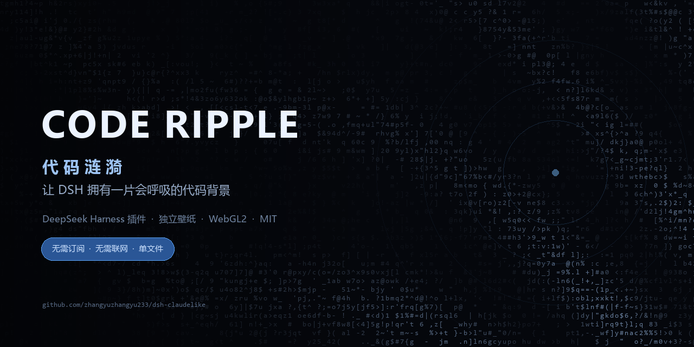
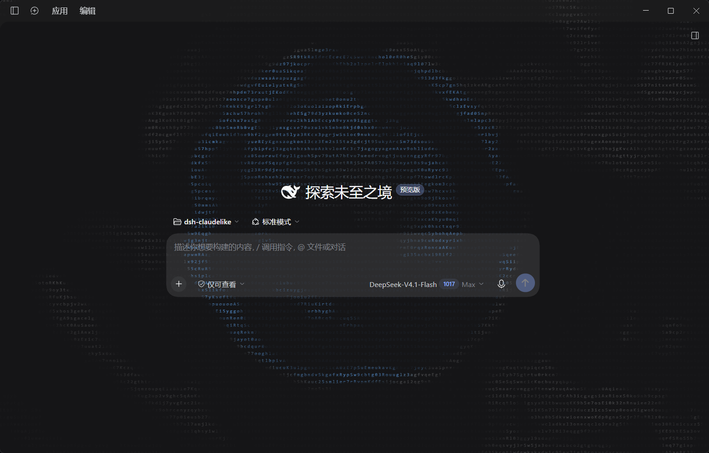

<div align="center">
  
</div>

# dsh-coderipple

> 想要 Claude 桌面端那种「一整片代码在呼吸」的动态背景，又不想为了一张背景去订阅、折腾账号？
> 这个插件把那层效果做成了自己的——装进 DSH 就能用，也能单独当壁纸。



一片**会呼吸的代码**：成片的等宽字符被一阵缓慢转向的风吹亮，每个格子按自己的节奏换字；指针划过留下一串余温，点击处荡开一圈由字符组成的水波（每第 3 次点击是心形）。全部是 WebGL2 实时算的，不是贴图，也没有任何网络请求。

## 最新更新 · v2.1.1：只覆盖会话面板，背景保持明显

- **背景严格限定在主会话面板内**：插件只在 `centerCol`（会话列）里创建画布，找不到会话面板就**不渲染**，不再回退到整窗。侧栏、顶栏、底栏都不会被盖住。
- **去掉压暗蒙版**：不再在字符层上叠任何遮罩，背景保持清晰、明显；同时把渲染不透明度从约 0.78 提升到约 0.96，字符纹理更有存在感。
- 滚动、输入框、composer 仍保持原生观感；背景随会话面板尺寸和侧栏折叠自动重测。
- 版本号 `2.1.1`（`2.1.0` 修复了背景越界问题，本版去掉了那层压暗衬层并加强可见度）。

升级方式：更新 `code-ripple-background/` 后重启 DSH（或刷新页面）即可，插件会自动卸载旧层并挂载新层。

## 两个形态，同一套引擎

| 目录 | 是什么 |
|---|---|
| [`code-ripple-background/`](code-ripple-background) | **DeepSeek Harness Web UI 插件**。装在 DSH 里，只铺满主会话面板且保持明显 |
| [`wallpaper/`](wallpaper) | **独立壁纸**：单文件 HTML，可直接在浏览器 / Lively 使用，也能录成无缝循环视频喂给 Razer Axon 这类只吃视频的壁纸工具 |

## 亮点

- **实时风场**：阵风、细流、大尺度涌浪三层噪声叠加，光带真的在走，不是循环动画。
- **字符会变**：每个格子有自己的字符序列和节奏，涟漪经过时加速翻滚——所以你看到的是「字符组成的波」，不是一圈光。
- **跟手的余温**：指针留下一串有时间衰减的暖点，字符被逐个点亮，停手后慢慢凉下去。
- **会话面板专属**：背景只存在于主会话列，侧栏、顶栏、底栏和右侧面板都干净。
- **明显的动态背景**：不叠加任何压暗蒙版，字符纹理全程清晰可见。
- **两种主题**：自动跟随 DSH 的明暗配色；壁纸版可用 `?theme=` 指定。
- **无订阅、无联网、无遥测**：纯前端 Canvas/WebGL2，复制一个文件夹就能跑。

## 一、DSH 插件

`code-ripple-background/` 是一个标准的 Cordis bundle（`dsh.bundle.patch` + `./client`），不依赖任何第三方运行时。

1. 把 `code-ripple-background/` 放到磁盘任意位置；
2. 在 DSH 的插件管理里「从本地目录安装」，或直接调用 Harness 的 `plugin_manager` 工具：

```text
install_bundle  target = <绝对路径>/code-ripple-background
```

3. 刷新页面。插件条目名为 **代码涟漪背景 / Code Ripple Background**，可以随时禁用。

实现要点：

- 整层挂在 `shell.overlay`，再挂进会话列 `centerCol`，`pointer-events: none`，不挡任何交互；
- 渲染分两趟：① 风场写进 `cols × rows*2` 的 RGBA8 缓冲；② 每个格子 6 个顶点（`gl_VertexID`）从字符图集里取字，按风场逐像素受光；
- 字符集是可打印 ASCII + `·`，16×6 图集；每个格子按种子轮流换字，涟漪经过时额外推进；
- 背景不加任何压暗遮罩，字符层以接近满强度（约 0.96）渲染，保持明显；
- 「第 3 次点击是心形」是沿用的彩蛋。

## 二、独立壁纸

```text
wallpaper/index.html     # 单文件，无依赖、无联网
```

- **浏览器**：双击打开，`F11` 全屏；
- **Lively Wallpaper**：添加壁纸 → 浏览 → 选 `index.html`；
- **Wallpaper Engine**：新建「网页」类型壁纸，入口选 `index.html`；
- **Razer Axon / 只吃视频的工具**：先录成无缝循环视频

```powershell
pwsh -File wallpaper/record.ps1                 # 1920x1080，约 77 秒无缝循环
pwsh -File wallpaper/record.ps1 -Theme light -Seed 42
```

`record.ps1` 会用 Edge 的 kiosk 模式打开页面、用 ffmpeg 的 `gdigrab` 抓屏，再把尾部交叉淡入头部（`xfade`），得到首尾相接的循环。需要 ffmpeg（脚本会自动找 PATH 或常见安装位置）和 Edge/Chrome。

### 可调参数

在地址后加查询串，例如 `index.html?theme=light&cell=7&seed=1234`：

| 参数 | 取值 | 默认 | 说明 |
|---|---|---|---|
| `theme` | `dark` / `light` | `dark` | 配色 |
| `cell` | 4–24 | `6.5` | 格子宽度（CSS px），越小字越密 |
| `look` | `mixed` / `lettered` / `figured` | `mixed` | 字符轮换序列 |
| `seed` | 任意整数 | 随机 | 固定风向/风速/阵风尺寸，复现同一种气质 |
| `auto` | `1` / `0` | `1` | 无人操作时是否自动生成涟漪 |
| `capture` | `1` / `0` | `0` | 录制模式：隐藏提示文字，配合 `record.ps1` |

## 环境要求

- 需要 **WebGL2** 与硬件加速；软件渲染（SwiftShader 之类）会被跳过；
- 插件面向 DSH Web UI；壁纸 HTML 在任何现代浏览器可用；
- `record.ps1` 只支持 Windows（PowerShell + Edge/Chrome + ffmpeg）。

## 许可

[MIT](LICENSE)。

## 关于出处

视觉语言参考了 Claude 桌面版落地页的「代码纹理」效果。这里的实现是独立重写的：没有包含、复制或分发任何 Anthropic 的代码或资源，本项目与 Anthropic 无关联、未获其背书。

---

**English** — A wind-lit field of drifting code characters: a WebGL2 plugin for the DeepSeek Harness Web UI, confined to the main conversation panel and kept clearly visible, plus a standalone single-file live wallpaper with a seamless-video recorder. MIT licensed. The visual language is inspired by the Claude desktop landing texture; this is an independent reimplementation with no Anthropic code or assets included, and no affiliation.
