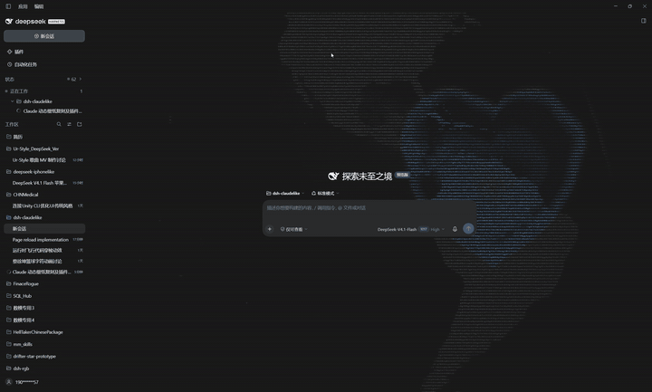

<div align="center">
  
</div>

# dsh-coderipple

> **让会话背景，成为一整套可切换的代码艺术。**

曾经，它是 Claude 桌面端那一整片会呼吸的代码；现在，它可以是 DeepSeek 的鲸鱼、系着围裙的鲸鱼女仆、一颗缓缓自转的立体地球、横向流动的大陆，或者干脆什么都没有。

全部由等宽代码字符实时拼成：跟着桌面一起呼吸，也会被你的鼠标点击打散，再在 1–2 秒内重新聚合。纯 WebGL2 实时计算，不是贴图，没有任何网络请求。

## 演示



> 真实录屏（GIF 已压缩）：立体地球自转、大陆轮廓与明暗，以及点击后涟漪把画面冲散、再重新聚合的过程。


## 最新更新 · v2.9.0：7 种背景预设

背景不再是固定效果，而是一套可切换的**代码艺术预设**。设置 → 通用里有两个独立下拉：

- **新会话背景**（Hero 页）
- **工作会话背景**（打开对话后）

两边都可以选以下任一预设：

| 预设 | 效果 |
|---|---|
| **（默认）** | 原版流动代码风场，字符随时间呼吸、指针余温、点击涟漪 |
| **无背景** | 整个背景层隐藏，只剩原生界面 |
| **DeepSeek 鲸鱼** | 官方鲸鱼矢量标，由代码字符拼成，居中、固定 |
| **鲸鱼女仆** | 灰度细节代码肖像：面板高 1.9 倍、围裙小鲸鱼兜子正好压在底边框 |
| **Q版鲸鱼女仆** | Q 版细节肖像，居中、高度占满面板 |
| **立体地球** | 真正的 3D 球体自转，只显示大陆（无海洋），50m 精度海岸线 |
| **大陆横移** | 平面世界大陆从左向右缓缓滚动，尺寸与立体地球一致 |

所有预设共享同一套交互：

- **区域交错高亮**：不同区域轮流变亮变暗（鲸鱼/女仆/地球）；
- **字符实时变动**：代码字符持续滚动换字；
- **点击涟漪**：鼠标点击处把画面冲散、穿孔、增亮，1–2 秒内自动还原；
- **只覆盖会话面板**、不加压暗蒙版；
- 不再覆盖输入框/标题栏的 sticky 定位（滚动不再拖走输入框）。

升级方式：更新 `code-ripple-background/` 后刷新 DSH 页面（或重启）即可。

## 两个形态，同一套引擎

| 目录 | 是什么 |
|---|---|
| [`code-ripple-background/`](code-ripple-background) | **DeepSeek Harness Web UI 插件**。装在 DSH 里，只铺满主会话面板且保持明显 |
| [`wallpaper/`](wallpaper) | **独立壁纸**：单文件 HTML，可直接在浏览器 / Lively 使用，也能录成无缝循环视频喂给 Razer Axon 这类只吃视频的壁纸工具 |

## 亮点

- **实时风场**：阵风、细流、大尺度涌浪三层噪声叠加，光带真的在走，不是循环动画。
- **字符会变**：每个格子有自己的字符序列和节奏，涟漪经过时加速翻滚——所以你看到的是「字符组成的波」，不是一圈光。
- **跟手的余温**：指针留下一串有时间衰减的暖点，字符被逐个点亮，停手后慢慢凉下去。
- **会话面板专属**：背景只存在于主会话列，侧栏、顶栏、底栏和右侧面板都干净。
- **明显的动态背景**：不叠加任何压暗蒙版，字符纹理全程清晰可见。
- **两种主题**：自动跟随 DSH 的明暗配色；壁纸版可用 `?theme=` 指定。
- **无订阅、无联网、无遥测**：纯前端 Canvas/WebGL2，复制一个文件夹就能跑。
- **7 种预设**：默认风场 / 无背景 / 鲸鱼 / 鲸鱼女仆 / Q版女仆 / 立体地球 / 大陆横移，新会话与工作会话可分别设置。

## 一、DSH 插件

`code-ripple-background/` 是一个标准的 Cordis bundle（`dsh.bundle.patch` + `./client`），不依赖任何第三方运行时。

1. 把 `code-ripple-background/` 放到磁盘任意位置；
2. 在 DSH 的插件管理里「从本地目录安装」，或直接调用 Harness 的 `plugin_manager` 工具：

```text
install_bundle  target = <绝对路径>/code-ripple-background
```

3. 刷新页面。插件条目名为 **代码涟漪背景 / Code Ripple Background**，可以随时禁用。

实现要点：

- 整层挂在 `shell.overlay`，再挂进会话列 `centerCol`，`pointer-events: none`，不挡任何交互；
- 渲染分两趟：① 风场写进 `cols × rows*2` 的 RGBA8 缓冲；② 每个格子 6 个顶点（`gl_VertexID`）从字符图集里取字，按风场逐像素受光；
- 字符集是可打印 ASCII + `·`，16×6 图集；每个格子按种子轮流换字，涟漪经过时额外推进；
- 背景不加任何压暗遮罩，字符层以接近满强度（约 0.96）渲染，保持明显；
- 「第 3 次点击是心形」是沿用的彩蛋。

## 二、独立壁纸

```text
wallpaper/index.html     # 单文件，无依赖、无联网
```

- **浏览器**：双击打开，`F11` 全屏；
- **Lively Wallpaper**：添加壁纸 → 浏览 → 选 `index.html`；
- **Wallpaper Engine**：新建「网页」类型壁纸，入口选 `index.html`；
- **Razer Axon / 只吃视频的工具**：先录成无缝循环视频

```powershell
pwsh -File wallpaper/record.ps1                 # 1920x1080，约 77 秒无缝循环
pwsh -File wallpaper/record.ps1 -Theme light -Seed 42
```

`record.ps1` 会用 Edge 的 kiosk 模式打开页面、用 ffmpeg 的 `gdigrab` 抓屏，再把尾部交叉淡入头部（`xfade`），得到首尾相接的循环。需要 ffmpeg（脚本会自动找 PATH 或常见安装位置）和 Edge/Chrome。

### 可调参数

在地址后加查询串，例如 `index.html?theme=light&cell=7&seed=1234`：

| 参数 | 取值 | 默认 | 说明 |
|---|---|---|---|
| `theme` | `dark` / `light` | `dark` | 配色 |
| `cell` | 4–24 | `6.5` | 格子宽度（CSS px），越小字越密 |
| `look` | `mixed` / `lettered` / `figured` | `mixed` | 字符轮换序列 |
| `seed` | 任意整数 | 随机 | 固定风向/风速/阵风尺寸，复现同一种气质 |
| `auto` | `1` / `0` | `1` | 无人操作时是否自动生成涟漪 |
| `capture` | `1` / `0` | `0` | 录制模式：隐藏提示文字，配合 `record.ps1` |

## 路线图：自定义素材（计划中）

预设只是起点。接下来会把背景系统开放为「**可导入素材**」：

- **静态素材**：立绘、人像、Logo、梗图……自动抠图后转成代码字符画；
- **动态素材**：循环视频 / 序列帧，让素材真正「动」在背景里；
- **内置调节**：字符密度、亮度与对比、区域高亮、涟漪强度；
- **每个会话独立设置**：像主题一样保存、切换与分享。

你可以把任何角色带进来——比如让 **蔡徐坤** 的循环在会话背后跳动，或者让 **时雨羽衣** 的立绘以代码字符的形式站在输入框后面。无论静态还是动态，都只是素材的一种。

> 以上为路线图，具体能力会随版本推进；欢迎 issue / PR 讨论你最想导入的素材。

## 环境要求

- 需要 **WebGL2** 与硬件加速；软件渲染（SwiftShader 之类）会被跳过；
- 插件面向 DSH Web UI；壁纸 HTML 在任何现代浏览器可用；
- `record.ps1` 只支持 Windows（PowerShell + Edge/Chrome + ffmpeg）。

## 许可

[MIT](LICENSE)。

## 关于出处

视觉语言参考了 Claude 桌面版落地页的「代码纹理」效果。这里的实现是独立重写的：没有包含、复制或分发任何 Anthropic 的代码或资源，本项目与 Anthropic 无关联、未获其背书。

---

**English** — A wind-lit field of drifting code characters: a WebGL2 plugin for the DeepSeek Harness Web UI, confined to the main conversation panel and kept clearly visible, plus seven switchable code-art background presets (ambient field, DeepSeek whale mark, maid portraits, a rotating 3D globe and scrolling continents) and a standalone single-file live wallpaper with a seamless-video recorder. The roadmap opens the background up to custom static and animated material imports. MIT licensed. The visual language is inspired by the Claude desktop landing texture; this is an independent reimplementation with no Anthropic code or assets included, and no affiliation.
